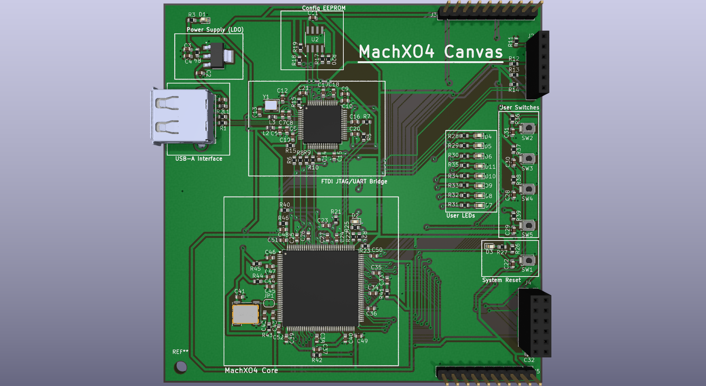

# MachXO4-Canvas

**MachXO4-Canvas** is a flexible, beginner-friendly FPGA development board designed specifically for educational use and DIY assembly. Built on a standard 100x100mm 2-layer PCB, this board eliminates standard manufacturing and assembly bottlenecks by utilizing robust, easy-to-solder components, including a massive through-hole USB-A female connector. 

With zero Design Rule Check (DRC) errors, this layout is highly optimized for standard 2-layer board house constraints.

## Repository Structure

Based on the project organization, here is where to find all relevant design and production files:

*   **[`/Doc`](Doc/)**[cite: 3]
    *   [`machx04_devboard.png`](Doc/machx04_devboard.png) - High-resolution 3D render of the final board[cite: 3].
    *   [`machx04_devboard.pdf`](Doc/machx04_devboard.pdf) - The complete system schematic[cite: 3].
    *   [`layout_final.pdf`](Doc/layout_final.pdf) - High-resolution 2D PCB layout for visual routing inspection[cite: 3].
*   **[`/Fabrication`](Fabrication/)**[cite: 3]
    *   [`machx04_gerber_files.zip`](Fabrication/machx04_gerber_files.zip) - The final, production-ready Gerber and Drill files[cite: 3].
*   **[`/Hardware`](Hardware/)**[cite: 3]
    *   Contains the native KiCad 8 source files (`.kicad_pro`, `.kicad_sch`, `.kicad_pcb`) and the `/Custom Library` folder for component footprints and symbols[cite: 3].

## Hardware Specifications

*   **Core Processor:** MachXO4 FPGA paired with a dedicated configuration EEPROM.
*   **Programming Interface:** Onboard FTDI JTAG/UART bridge for seamless flashing and serial communication directly over USB.
*   **Power Architecture:** 5V to 3.3V and 1.8V low-dropout (LDO) regulators with optimized thermal copper pours.
*   **User I/O:** Programmable onboard LEDs, tactile user switches, and a dedicated hardware system reset.
*   **Form Factor & Connectivity:** 100x100mm Edge.Cuts with a robust, 4-pin female USB-A interface, entirely removing the microscopic drill constraints of standard USB-C ports.

## Fabrication & Manufacturing

This board is fully validated for standard, low-cost 2-layer manufacturing. 
To manufacture this board, simply provide the factory with the **[Gerber Release ZIP](Fabrication/machx04_gerber_files.zip)**[cite: 3]. 

If your fabrication engineer requires a visual preview before running the job, you can share the **[2D Layout PDF](Doc/layout_final.pdf)**[cite: 3] and the **[System Schematic](Doc/machx04_devboard.pdf)**[cite: 3].

## Modifying the Design

To open and modify this project:
1. Clone this repository to your local machine.
2. Ensure you have KiCad installed.
3. Navigate to the `Hardware/` directory and open `machx04_devboard.kicad_pro`[cite: 3].
4. The project utilizes localized parts in the `Hardware/Custom Library/` folder, which should link automatically upon opening[cite: 3].
